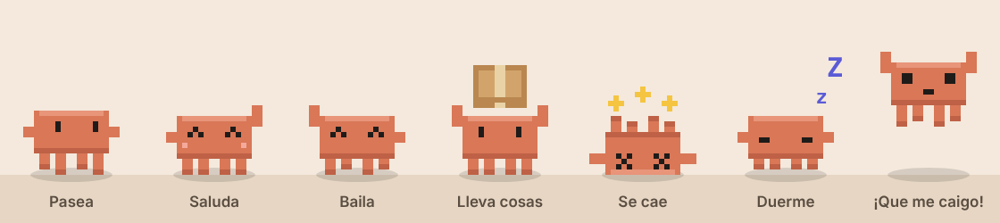

# Clawdy, una mascota de escritorio con la que puedes hablar

<p align="center"></p>

**Clawdy** es un monigote pixel art naranja, inspirado en el de Claude, que vive en la parte de abajo de tu pantalla. Pasea, se tropieza, se duerme cuando no usas el ordenador, juega con una pelota y lleva cajas y documentos de un lado a otro. Además, puedes **hablar con él**: está conectado a Claude, así que si le dices "quédate quieto", "sígueme" o "lleva la caja a la izquierda", lo hace.

> Proyecto de fans, sin relación oficial con Anthropic. "Claude" es una marca de Anthropic.

## Qué hace

- 🚶 **Pasea** por la pantalla, encima de todas las ventanas, sin molestar: los clics pasan a las ventanas de debajo salvo cuando tocas al monigote o a sus objetos.
- 🤕 **Se cae**: a veces se tropieza andando y acaba boca arriba pataleando. Si lo coges con el ratón y lo sueltas desde arriba, cae con un buen *plaf*.
- 😴 **Se duerme** si no tocas el teclado ni el ratón durante un rato (2 minutos por defecto) y se despierta cuando vuelves.
- 📦 **Mueve cosas**: una pelota, cajas y documentos. Los coge, se los pone en la cabeza y los lleva a otro sitio. La pelota la empuja y le da patadas.
- 🖱️ **Interacción**: clic para hacerle cosquillas, arrastrar para cogerlo (¡y lanzarlo!), doble clic para hablar con él y clic derecho para ver el menú.
- 💬 **Chat con Claude**: le escribes y responde en un bocadillo encima de su cabeza. Usa *tool use* para controlar su propio cuerpo:
  - "Quédate quieto" / "Vuelve a pasear" / "Sígueme"
  - "Baila", "salta", "saluda", "haz como que te caes", "duérmete"
  - "Saca una caja y llévala a la derecha", "dale una patada a la pelota"

## Descargar

Ve a **[Releases](https://github.com/Alex-og-master/desktop-pet-claude/releases)** y descarga el archivo de tu sistema:

| Sistema | Archivo |
|---|---|
| Windows | `Clawdy-Setup-x.y.z.exe` (instalador) o `Clawdy-x.y.z-portable.exe` (sin instalar) |
| macOS | `Clawdy-x.y.z-universal.dmg` |
| Linux | `Clawdy-x.y.z.AppImage` o `.deb` |

Los ejecutables no están firmados con un certificado de pago, así que el sistema te avisará la primera vez:

- **Windows**: en el aviso de SmartScreen pulsa *Más información → Ejecutar de todas formas*.
- **macOS**: arrastra la app a *Aplicaciones*, haz clic derecho sobre ella y elige *Abrir*. Si dice que está dañada, ejecuta `xattr -cr /Applications/Clawdy.app` en la Terminal.
- **Linux**: dale permisos al AppImage (`chmod +x Clawdy-*.AppImage`) y ábrelo.

Clawdy no aparece en la barra de tareas: lo controlas desde el **icono de la bandeja del sistema** (junto al reloj) o con **clic derecho** sobre él.

## Hablar con Clawdy

Para el chat hace falta una API key de Anthropic:

1. Créala en [console.anthropic.com](https://console.anthropic.com/) (*API Keys*).
2. Haz doble clic en Clawdy y pulsa ⚙ en la ventana del chat.
3. Pega la clave y guarda.

La clave se guarda **cifrada en tu ordenador** con el llavero del sistema y solo se envía a la API de Anthropic. También puedes usar la variable de entorno `ANTHROPIC_API_KEY`.

En ajustes puedes elegir el modelo: **Claude Opus 5.5** (por defecto, el más listo), **Sonnet 5.5** o **Haiku 5.5** (el más rápido y barato, de sobra para charlar con una mascota). Cada mensaje cuesta muy poco, pero se cobra en tu cuenta de Anthropic.

## Ejecutarlo desde el código

Necesitas [Node.js](https://nodejs.org/) 20 o superior.

```bash
git clone https://github.com/Alex-og-master/desktop-pet-claude.git
cd desktop-pet-claude
npm install
npm start
```

Otros comandos:

```bash
npm run check       # comprobaciones rápidas (sintaxis, herramientas, iconos)
npm run icons       # regenera los iconos a partir del sprite
npm run dist        # crea el instalador para tu sistema en dist/
PET_DEBUG=1 npm start   # muestra en la terminal los mensajes de la mascota
```

## Publicar una versión nueva

Los instaladores se generan solos con GitHub Actions al subir una etiqueta:

```bash
# sube la versión en package.json y luego:
git tag v0.1.0
git push origin v0.1.0
```

El workflow [`release.yml`](.github/workflows/release.yml) compila en Windows, macOS y Linux y sube los archivos a la página de Releases.

## Cómo funciona

```
src/
├── main/
│   ├── main.js        Ventanas, bandeja, menú e IPC (proceso principal de Electron)
│   ├── claude.js      Conversación con Claude y herramientas de la mascota
│   └── settings.js    Ajustes y API key cifrada
├── preload/           Puentes seguros entre Electron y las páginas
├── renderer/
│   ├── pet/           La mascota: sprite pixel art + motor (estados, físicas, objetos)
│   └── chat/          La ventana de chat y ajustes
└── assets/            Iconos
```

- La mascota se dibuja en un `<canvas>` dentro de una **ventana transparente** que ocupa toda la pantalla y está siempre encima. El proceso principal mira dónde está el puntero unas 30 veces por segundo y solo atrapa el ratón cuando está encima de la mascota o de un objeto. Así puedes seguir usando el ordenador con normalidad.
- El dibujo es pixel art generado con código (`sprite.js`), así que añadir poses o expresiones es cuestión de pintar unos cuantos rectángulos.
- El comportamiento es una máquina de estados (`pet.js`): `idle`, `walk`, `trip`, `air`, `sleep`, `dance`… Un pequeño "cerebro" elige qué hacer cuando está libre.
- El chat usa la [API de Claude](https://docs.claude.com/) con *tool use*. Claude recibe el estado actual de la mascota y herramientas como `set_mode`, `move_to`, `do_action`, `move_object` o `spawn_object`. Cuando las usa, el proceso principal se las pasa a la mascota y le devuelve el resultado.

## Limitaciones conocidas

- Los "objetos del escritorio" son juguetes de la propia mascota (pelota, caja, documento). **No mueve los iconos ni los archivos reales** de tu escritorio: hacerlo depende de cada sistema operativo, es frágil y podría desordenarte el escritorio.
- Solo vive en la **pantalla principal**.
- En Linux con **Wayland**, el sueño automático y el seguimiento del ratón pueden no funcionar, porque Wayland no deja que las apps lean el puntero ni el tiempo de inactividad. Con X11 funciona todo. La transparencia necesita un compositor (lo normal en GNOME y KDE).
- "Abrir al iniciar sesión" funciona en Windows y macOS.

## Ideas para seguir

- Más objetos y que la mascota trepe por los bordes de las ventanas.
- Varias pantallas.
- Que te avise de cosas: recordatorios o un temporizador Pomodoro.
- Skins: cambiar colores o accesorios (gorritos 🎩).

¿Tienes una idea? Abre un *issue* o un *pull request*.

## Licencia

[MIT](LICENSE)
